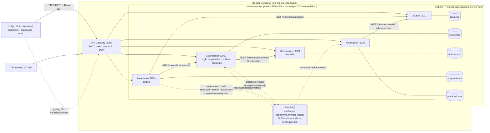
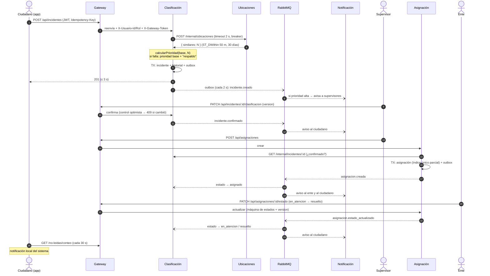

# Arquitectura de URBANSYNC (MVP local)

## Vista general

Flechas **continuas** = llamadas **síncronas** (HTTP/REST). Flechas **punteadas** = mensajes
**asíncronos** (eventos por RabbitMQ).

## Flujo principal (secuencia)

## Patrones de sistemas distribuidos aplicados

| Patrón | Dónde | Para qué |
|---|---|---|
| API Gateway | `gateway/` | Punto único de entrada; autenticación (JWT), autorización por rol, rate limit, 503 en español |
| Base de datos por servicio | un esquema por servicio, sin FK entre esquemas | Aislamiento y despliegue independiente |
| Comunicación asíncrona por eventos | RabbitMQ topic + colas durables | Desacoplar; tolerar la caída de un consumidor (PT-01) |
| Transactional Outbox | `comun/outbox.js`, tablas `outbox` | No perder eventos si el broker cae (PT-03) |
| Consumidor idempotente | tablas `eventos_procesados` | Entrega "al menos una vez" sin duplicar efectos |
| Reintentos + Dead Letter Queue | `comun/mensajeria.js` | 3 reintentos (200/400/800 ms) y luego `urbansync.dlq` |
| Circuit breaker | `comun/breaker.js` | Fallar rápido y usar el plan B (PT-02) |
| Timeout + reintentos con backoff y jitter | `comun/httpResiliente.js` | Llamadas síncronas resilientes (solo 5xx/red) |
| Degradación elegante | prioridad de respaldo + recálculo cada 60 s | El reporte nunca se pierde |
| Control optimista de concurrencia | columna `version` → 409 | Dos supervisores editando a la vez |
| Restricción única parcial | `uq_asignacion_activa` | Una sola asignación activa (PC-02) |
| Idempotency-Key | `POST /api/incidentes` | Reintentos de la app sin duplicar (PC-03) |
| Health checks + reinicio automático | `docker-compose.yml` | Autorecuperación (PT-04) |
| Correlación de logs | `X-Request-Id` propagado, logs JSON (pino) | Seguir una petición entre servicios |

## Seguridad en capas

1. **Gateway**: valida el JWT (HS256, emisor `urbansync`) → 401; valida el rol por método y ruta → 403;
   elimina `X-Usuario-*` y `X-Gateway-Token` enviados por el cliente; helmet; 100 kb; rate limit.
2. **Red**: solo el gateway (8080) está publicado; los servicios no son accesibles desde fuera.
3. **Servicio**: exige `X-Gateway-Token` (comparación en tiempo constante) → 401; vuelve a validar el rol
   y la **propiedad del recurso** (un ciudadano solo ve sus reportes → 403, OWASP API1).
4. **Datos**: contraseñas con bcrypt (costo 10), bloqueo tras 5 intentos, token de recuperación
   guardado como hash SHA-256 y de un solo uso, SQL siempre parametrizado, validación con zod.
